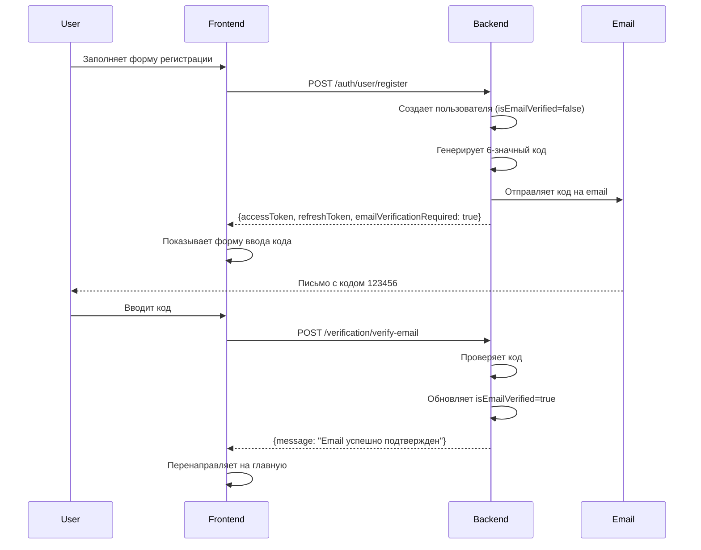
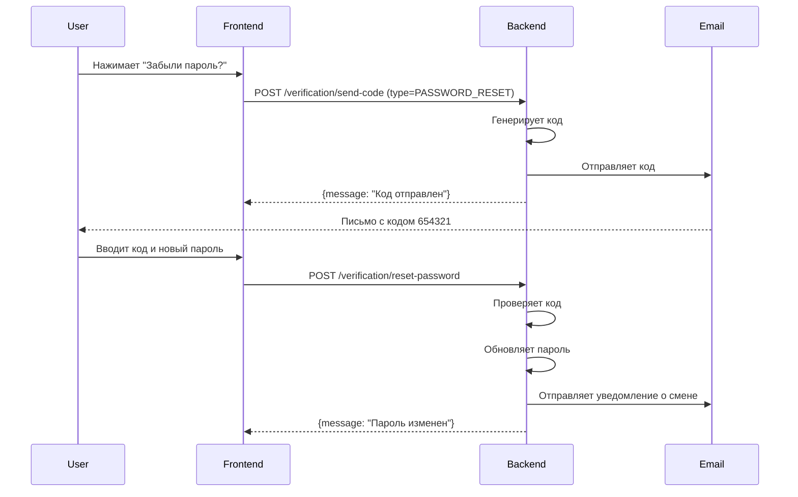
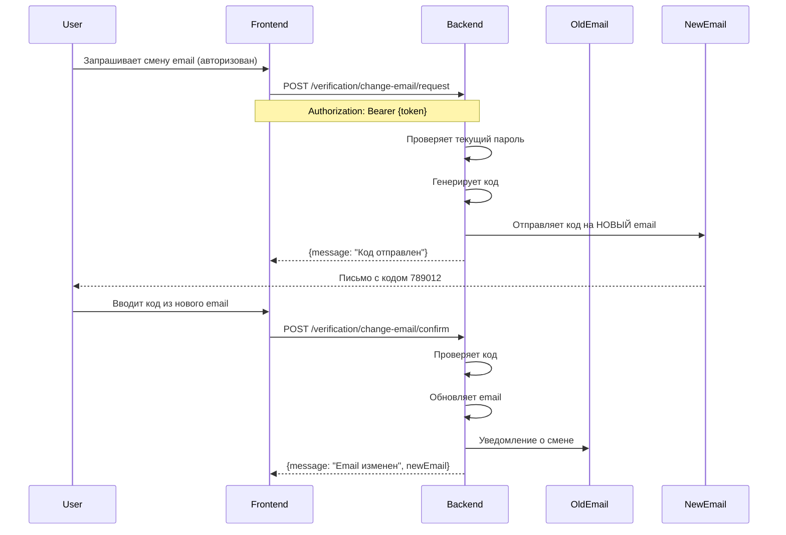

# Email Verification API

Документация по API верификации email с 6-значными кодами подтверждения.

## Базовый URL

```
https://api.eventflow.uz/api/v1
```

## Оглавление

- [Подтверждение Email при регистрации](#подтверждение-email-при-регистрации)
- [Сброс пароля](#сброс-пароля)
- [Смена Email](#смена-email)
- [Endpoints](#endpoints)
- [Типы данных](#типы-данных)
- [Обработка ошибок](#обработка-ошибок)

---

## Подтверждение Email при регистрации

### Flow



### Шаги

1. **Регистрация**
   ```http
   POST /auth/user/register
   Content-Type: application/json

   {
     "email": "user@example.com",
     "password": "SecurePassword123!",
     "firstName": "Иван",
     "lastName": "Иванов"
   }
   ```

   **Response:**
   ```json
   {
     "accessToken": "eyJhbGciOiJIUzI1NiIsInR5cCI6IkpXVCJ9...",
     "refreshToken": "dGhpcyBpcyBhIHJlZnJlc2ggdG9rZW4...",
     "emailVerificationRequired": true
   }
   ```

2. **Пользователь получает email** с 6-значным кодом (действителен 5 минут)

3. **Подтверждение email**
   ```http
   POST /verification/verify-email
   Content-Type: application/json

   {
     "email": "user@example.com",
     "code": "123456"
   }
   ```

   **Response:**
   ```json
   {
     "message": "Email успешно подтвержден"
   }
   ```

4. **Повторная отправка кода** (если не пришел)
   ```http
   POST /verification/resend-code
   Content-Type: application/json

   {
     "email": "user@example.com",
     "type": "EMAIL_VERIFICATION"
   }
   ```

   **Rate Limit:** 1 запрос в минуту

---

## Сброс пароля

### Flow



### Шаги

1. **Запрос кода сброса**
   ```http
   POST /verification/send-code
   Content-Type: application/json

   {
     "email": "user@example.com",
     "type": "PASSWORD_RESET"
   }
   ```

2. **Сброс пароля с кодом**
   ```http
   POST /verification/reset-password
   Content-Type: application/json

   {
     "email": "user@example.com",
     "code": "654321",
     "newPassword": "NewSecurePassword123!"
   }
   ```

---

## Смена Email

### Flow



### Шаги

1. **Запрос смены email**
   ```http
   POST /verification/change-email/request
   Authorization: Bearer {accessToken}
   Content-Type: application/json

   {
     "newEmail": "newemail@example.com",
     "currentPassword": "CurrentPassword123!"
   }
   ```

2. **Подтверждение смены**
   ```http
   POST /verification/change-email/confirm
   Authorization: Bearer {accessToken}
   Content-Type: application/json

   {
     "code": "789012"
   }
   ```

   **Response:**
   ```json
   {
     "message": "Email успешно изменен",
     "newEmail": "newemail@example.com"
   }
   ```

---

## Endpoints

### Public Endpoints

#### POST `/verification/send-code`

Отправка кода верификации на email.

**Rate Limit:** 3 запроса в минуту

**Request:**
```json
{
  "email": "user@example.com",
  "type": "EMAIL_VERIFICATION" | "PASSWORD_RESET"
}
```

**Response:**
```json
{
  "message": "Код отправлен на email"
}
```

---

#### POST `/verification/verify-email`

Подтверждение email по коду.

**Rate Limit:** 5 попыток в минуту

**Request:**
```json
{
  "email": "user@example.com",
  "code": "123456"
}
```

**Response:**
```json
{
  "message": "Email успешно подтвержден"
}
```

---

#### POST `/verification/reset-password`

Сброс пароля с кодом верификации.

**Rate Limit:** 5 попыток в минуту

**Request:**
```json
{
  "email": "user@example.com",
  "code": "654321",
  "newPassword": "NewSecurePassword123!"
}
```

**Response:**
```json
{
  "message": "Пароль успешно изменен"
}
```

---

#### POST `/verification/resend-code`

Повторная отправка кода.

**Rate Limit:** 1 запрос в минуту

**Request:**
```json
{
  "email": "user@example.com",
  "type": "EMAIL_VERIFICATION" | "PASSWORD_RESET"
}
```

**Response:**
```json
{
  "message": "Код повторно отправлен на email"
}
```

---

### Protected Endpoints (требуется авторизация)

#### POST `/verification/change-email/request`

Запрос на смену email.

**Headers:**
```
Authorization: Bearer {accessToken}
```

**Request:**
```json
{
  "newEmail": "newemail@example.com",
  "currentPassword": "CurrentPassword123!"
}
```

**Response:**
```json
{
  "message": "Код подтверждения отправлен на новый email"
}
```

---

#### POST `/verification/change-email/confirm`

Подтверждение смены email.

**Headers:**
```
Authorization: Bearer {accessToken}
```

**Request:**
```json
{
  "code": "789012"
}
```

**Response:**
```json
{
  "message": "Email успешно изменен",
  "newEmail": "newemail@example.com"
}
```

---

## Типы данных

### VerificationCodeType

```typescript
enum VerificationCodeType {
  EMAIL_VERIFICATION = 'EMAIL_VERIFICATION',  // Подтверждение email
  PASSWORD_RESET = 'PASSWORD_RESET',          // Сброс пароля
  EMAIL_CHANGE = 'EMAIL_CHANGE',              // Смена email
}
```

### Код верификации

- **Формат:** 6 цифр (000000 - 999999)
- **Срок действия:** 5 минут
- **Максимум попыток:** 5 неудачных попыток
- **Регенерация:** При создании нового кода все старые коды инвалидируются

---

## Обработка ошибок

### Коды ошибок

| Код | Описание | Решение |
|-----|----------|---------|
| 400 | Неверный или истекший код | Запросить новый код через `/resend-code` |
| 400 | Превышено количество попыток | Запросить новый код через `/resend-code` |
| 400 | Подождите N секунд перед повторной отправкой | Дождаться окончания таймера |
| 404 | Пользователь не найден | Проверить email |
| 409 | Email уже используется | Использовать другой email |
| 429 | Слишком много запросов | Дождаться окончания rate limit |

### Примеры ошибок

**Неверный код:**
```json
{
  "statusCode": 400,
  "message": "Неверный код. Осталось попыток: 3",
  "timestamp": "2026-01-14T12:00:00.000Z",
  "path": "/api/v1/verification/verify-email"
}
```

**Код истек:**
```json
{
  "statusCode": 400,
  "message": "Код истек. Запросите новый код",
  "timestamp": "2026-01-14T12:00:00.000Z",
  "path": "/api/v1/verification/verify-email"
}
```

**Rate limit:**
```json
{
  "statusCode": 429,
  "message": "ThrottlerException: Too Many Requests",
  "timestamp": "2026-01-14T12:00:00.000Z",
  "path": "/api/v1/verification/send-code"
}
```

---

## UI/UX рекомендации

### Форма ввода кода

1. **6 отдельных полей** для каждой цифры (лучший UX)
   - Автофокус на первое поле
   - Автоматический переход на следующее поле при вводе
   - Backspace переходит на предыдущее поле

2. **Таймер обратного отсчета**
   ```
   Код действителен: 04:32
   ```

3. **Кнопка "Отправить код повторно"**
   - Активна только после истечения 60 секунд
   - Показывает таймер: "Отправить повторно через 45 сек"

4. **Обработка ошибок**
   - Показывать оставшиеся попытки
   - При превышении лимита предложить запросить новый код
   - Визуально выделять неверно введенный код (красная рамка)

### Примеры состояний

**Ожидание ввода:**
```
┌─────────────────────────────────────┐
│  Введите код из email               │
│                                     │
│  ┌───┐ ┌───┐ ┌───┐ ┌───┐ ┌───┐ ┌───┐ │
│  │ 1 │ │ 2 │ │ 3 │ │ 4 │ │ 5 │ │ 6 │ │
│  └───┘ └───┘ └───┘ └───┘ └───┘ └───┘ │
│                                     │
│  Код действителен: 04:32            │
│  Отправить повторно через 45 сек    │
└─────────────────────────────────────┘
```

**Ошибка:**
```
┌─────────────────────────────────────┐
│  ❌ Неверный код. Осталось 3 попытки│
│                                     │
│  ┌───┐ ┌───┐ ┌───┐ ┌───┐ ┌───┐ ┌───┐ │
│  │ 1 │ │ 2 │ │ 3 │ │ 4 │ │ 5 │ │ 6 │ │
│  └───┘ └───┘ └───┘ └───┘ └───┘ └───┘ │
│  (красная рамка)                    │
└─────────────────────────────────────┘
```

**Успех:**
```
┌─────────────────────────────────────┐
│  ✅ Email успешно подтвержден       │
│                                     │
│  Перенаправление на главную...      │
└─────────────────────────────────────┘
```

---

## Безопасность

### Защита от brute-force

1. **Rate Limiting**
   - `/send-code`: 3 запроса в минуту
   - `/verify-email`: 5 попыток в минуту
   - `/resend-code`: 1 запрос в минуту

2. **Ограничение попыток**
   - Максимум 5 неудачных попыток ввода кода
   - После 5 попыток код инвалидируется

3. **Таймаут повторной отправки**
   - Минимум 60 секунд между отправками

### Хранение кодов

- Коды хранятся в plain text (они одноразовые и короткоживущие)
- Автоматическая инвалидация истекших кодов
- При создании нового кода все старые коды инвалидируются

---

## Поддержка разных типов пользователей

API работает для всех типов пользователей:

- **User** - обычные пользователи
- **Organization** - организации
- **Member** - сотрудники организаций

Backend автоматически определяет тип пользователя по email.

---

## Примеры интеграции

### React Hook для верификации email

```typescript
import { useState, useEffect } from 'react';
import { api } from '@/lib/api';

export function useEmailVerification(email: string) {
  const [code, setCode] = useState('');
  const [timeLeft, setTimeLeft] = useState(300); // 5 минут
  const [canResend, setCanResend] = useState(false);
  const [error, setError] = useState('');
  const [loading, setLoading] = useState(false);

  useEffect(() => {
    if (timeLeft <= 0) return;
    
    const timer = setInterval(() => {
      setTimeLeft(prev => {
        if (prev <= 1) {
          setCanResend(true);
          return 0;
        }
        return prev - 1;
      });
    }, 1000);

    return () => clearInterval(timer);
  }, [timeLeft]);

  const verifyCode = async () => {
    setLoading(true);
    setError('');
    
    try {
      await api.post('/verification/verify-email', { email, code });
      return true;
    } catch (err: any) {
      setError(err.response?.data?.message || 'Ошибка проверки кода');
      return false;
    } finally {
      setLoading(false);
    }
  };

  const resendCode = async () => {
    if (!canResend) return;
    
    setLoading(true);
    setError('');
    
    try {
      await api.post('/verification/resend-code', {
        email,
        type: 'EMAIL_VERIFICATION'
      });
      setTimeLeft(300);
      setCanResend(false);
    } catch (err: any) {
      setError(err.response?.data?.message || 'Ошибка отправки кода');
    } finally {
      setLoading(false);
    }
  };

  return {
    code,
    setCode,
    timeLeft,
    canResend,
    error,
    loading,
    verifyCode,
    resendCode,
  };
}
```

---

## Тестирование

### Тестовые сценарии

1. **Успешная верификация**
   - Регистрация → получение кода → ввод кода → успех

2. **Неверный код**
   - Ввод неверного кода → ошибка с оставшимися попытками

3. **Истекший код**
   - Ожидание 5+ минут → ввод кода → ошибка "код истек"

4. **Превышение попыток**
   - 5 неудачных попыток → код инвалидирован → требуется новый код

5. **Повторная отправка**
   - Запрос нового кода → старый код инвалидирован → новый код работает

6. **Rate limiting**
   - Множественные запросы → 429 Too Many Requests

---

## Супер-админ API

### GET `/super-admin/verification-codes`

Получение истории всех кодов верификации (только для супер-админа).

**Headers:**
```
Authorization: Bearer {superAdminAccessToken}
```

**Query Parameters:**
- `page` (number, default: 1)
- `limit` (number, default: 50)
- `email` (string, optional)
- `type` (VerificationCodeType, optional)
- `actorType` (UserType, optional)
- `isUsed` (boolean, optional)
- `sort` (string, default: "-createdAt")

**Response:**
```json
{
  "data": [
    {
      "id": "uuid",
      "code": "123456",
      "email": "user@example.com",
      "type": "EMAIL_VERIFICATION",
      "actorType": "USER",
      "actorId": "uuid",
      "newEmail": null,
      "isUsed": false,
      "usedAt": null,
      "expiresAt": "2026-01-14T12:05:00Z",
      "attempts": 1,
      "createdAt": "2026-01-14T12:00:00Z"
    }
  ],
  "total": 150,
  "page": 1,
  "limit": 50,
  "totalPages": 3
}
```

---

## Changelog

### v1.0.0 (2026-01-14)
- Начальная версия API верификации email
- Поддержка подтверждения email, сброса пароля, смены email
- Rate limiting на всех endpoints
- Супер-админ API для мониторинга кодов
