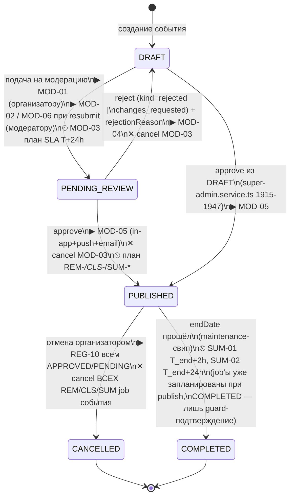
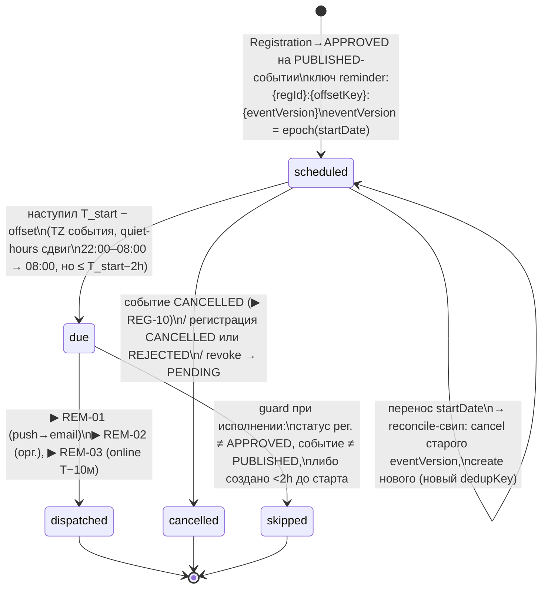
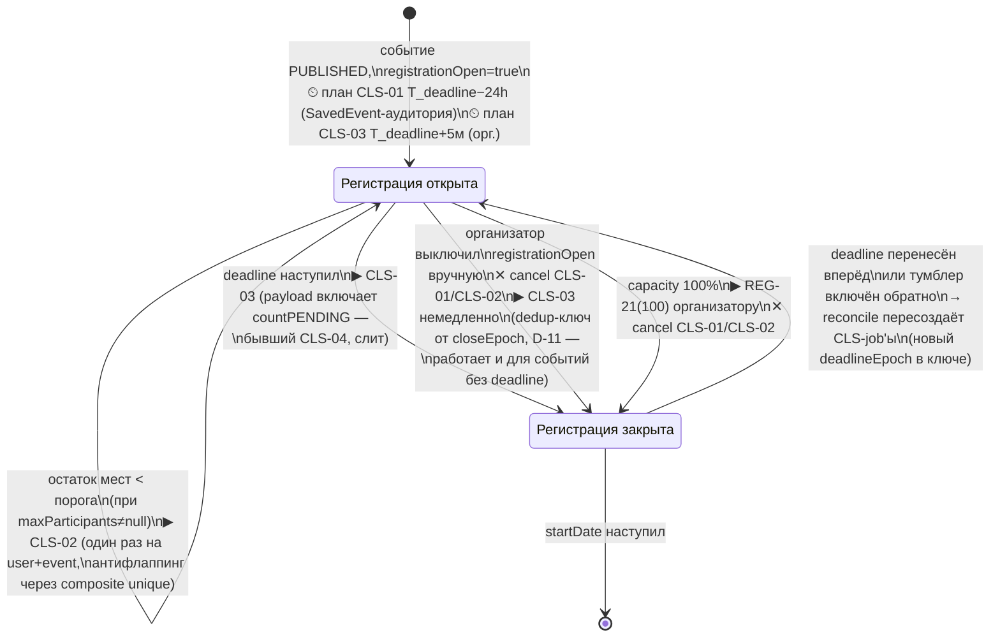
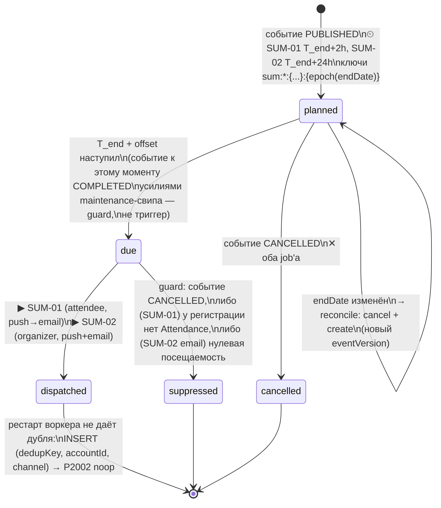
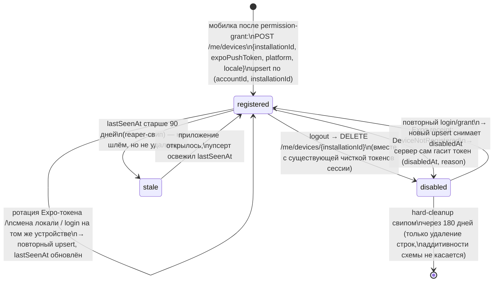

# STATE_MACHINES — реальные машины состояний и точки эмиссии уведомлений

Фаза 2 (A2, design-only). Все состояния — РЕАЛЬНЫЕ значения enum'ов из `apps/api/prisma/schema.prisma`; идеализированные статусы из ТЗ, которых нет в схеме, сюда не попали (расхождения — в [NOTIFICATIONS_CATALOG.md](NOTIFICATIONS_CATALOG.md), раздел 0). На переходах — ID уведомлений из каталога.

## 1. Цепочка 1 — Модерация события (`EventStatus`)

Реальный enum: `DRAFT | PENDING_REVIEW | PUBLISHED | CANCELLED | COMPLETED`. «Запрошены правки» и «отклонено» — один переход `PENDING_REVIEW→DRAFT`, различаются `kind` в payload (MOD-04).



Примечания:
- `MOD-03` (SLA) — не переход, а таймер на состоянии `PENDING_REVIEW`; любой выход из состояния отменяет job.
- Пунктирного `UNPUBLISHED` нет: снятие с публикации в продукте отсутствует (только `CANCELLED` или soft-delete супер-админом, который каскадно гасит job'ы так же, как CANCELLED).

## 2. Цепочка 2 — Регистрация + оплата (`RegistrationStatus` × `OrderStatus`)

Две связанные машины: `Registration` (`PENDING | APPROVED | REJECTED | CANCELLED`) и её платёжное плечо `Order kind=TICKET_SALE` (`PENDING_PAYMENT | PAID | EXPIRED | CANCELLED | REFUNDED`; hold 15 минут). Билет и check-in — не статусы (поля `ticketIssuedAt` + строки `Attendance`).

NB (B-05): полный enum `OrderStatus` содержит ещё `REQUESTED` — и это `@default` (`schema.prisma:2396-2432`); Order — общая модель с биллингом. Диаграмма описывает ТОЛЬКО `kind=TICKET_SALE`; все guard'ы, `cancelBy({orderId})` и точки эмиссии Order-плеча (включая REG-05 по `PaymentTransaction FAILED` и REG-12/REG-23) обязаны явно фильтровать `kind=TICKET_SALE`, иначе цепочка зацепит биллинговые заказы других kind.

```mermaid
stateDiagram-v2
    state Registration {
        [*] --> R_PENDING : register()\n▶ REG-01 (участнику)\n▶ EXIST-N-01 in-app (орг.)\n▶ REG-20 если первая\n▶ REG-21 при пороге 50/80/100
        R_PENDING --> R_APPROVED : approve организатором\nили confirmTicketPaid\n▶ REG-06\n▶ REG-08 (билет; коалесценция ≤60с)\n⏲ план REM-01/REM-03
        R_PENDING --> R_REJECTED : reject + reason\n▶ REG-07
        R_APPROVED --> R_PENDING : revoke\n▶ REG-11\n✕ cancel REM-* регистрации
        R_PENDING --> R_CANCELLED : cancel (терминальный)\n▶ REG-10\n✕ cancel job'ы регистрации
        R_APPROVED --> R_CANCELLED : cancel организатором\n▶ REG-10 (+судьба денег при PAID)\n✕ cancel REM/SUM job регистрации
        R_REJECTED --> [*]
        R_CANCELLED --> [*]
    }

    state Order_TICKET_SALE {
        [*] --> O_PENDING_PAYMENT : checkout() поверх PENDING-рег.\nhold = 15 мин\n▶ REG-02\n⏲ REG-03 T+10м, REG-04 T+15м
        O_PENDING_PAYMENT --> O_PAID : подтверждение оплаты\n(провайдер/оператор)\n✕ cancel REG-03/REG-04\n→ Registration APPROVED (REG-06)
        O_PENDING_PAYMENT --> O_EXPIRED : hold истёк\n(job REG-04 = триггер экспирации)\n▶ REG-04 (участнику)\n▶ REG-23 in-app (орг.)
        O_PENDING_PAYMENT --> O_CANCELLED : отказ пользователя\n✕ cancel REG-03/REG-04
        O_PAID --> O_REFUNDED : возврат (оператор)\n▶ REG-12 (сумма UZS)\n▶ REG-23 (орг.)
        O_EXPIRED --> [*] : возможен новый checkout\n(идемпотентный, ticketing.service)
        O_REFUNDED --> [*]
        O_CANCELLED --> [*]
    }
```

Вне статусов: `PaymentTransaction → FAILED` при живом `PENDING_PAYMENT`-заказе ▶ REG-05; создание `Attendance` ▶ REG-09; `REG-22` — ежедневный дайджест организатору 09:00, не привязан к переходам. WAITLISTED/PROMOTED в схеме нет — на диаграмме отсутствуют осознанно.

## 3. Цепочка 3 — Напоминания (жизненный цикл REM-job)

Состояния здесь — статусы строки `ScheduledNotification`, а не домен-сущности.



Поздняя регистрация (`now > T_start − offset`): job создаётся сразу в `due`, если `T_start − now ≥ 2h`; иначе не создаётся (`skipped` при рождении).

## 4. Цепочка 4 — Закрытие регистрации (CLS)

Триггер — `registrationDeadline` (nullable) с учётом ручного тумблера `registrationOpen` (приоритетен над автологикой).



Guard каждого CLS-job: перед отправкой перечитать `registrationOpen`, статус события и (для CLS-01) отсутствие регистрации у получателя.

## 5. Цепочка 5 — Финальная сводка (SUM)



## 6. Жизненный цикл NotificationDelivery

Одна строка = одна доставка одному получателю по одному каналу. Замок идемпотентности — composite unique `(dedupKey, accountId, channel)`: `dedupKey` — семантический ключ уведомления БЕЗ получателя и канала, поэтому fan-out на N получателей и push→email fallback дают легальные соседние строки (B-04 закрыт), а повтор той же доставки — P2002 → noop.

```mermaid
stateDiagram-v2
    [*] --> scheduled : создана планировщиком\n(будущий send, ScheduledNotification-путь)
    [*] --> enqueued : sync-путь: Dispatcher INSERT\n+ enqueue в BullMQ (push.send / mail.send)\nP2002 на INSERT → noop, дубля нет
    scheduled --> enqueued : job наступил, guard пройден
    scheduled --> cancelled : каскадная инвалидация\n(cancelBy eventId/registrationId/orderId)
    scheduled --> skipped : guard не пройден при исполнении
    enqueued --> sent : канал принял\n(Expo ticket ok / SMTP accepted / in-app row created)
    enqueued --> failed : attempts исчерпаны (BullMQ)\nстрока видна reaper-у — «молчаливая потеря»\nиз аудита закрыта
    sent --> delivered : push: Expo receipt ok\n(опрос чеков отложенным job'ом)
    sent --> failed : push: receipt DeviceNotRegistered\n→ деактивация DeviceToken\n→ fallback email per-account (D-03б):\nтолько если у аккаунта не осталось устройств,\nполучивших push; новая delivery-строка\nс тем же dedupKey и channel=email
    enqueued --> suppressed : rate limit / preference off /\nEmailUnsubscribe / quiet hours drop
    delivered --> [*]
    failed --> [*]
    cancelled --> [*]
    skipped --> [*]
    suppressed --> [*]
```

Для email статус `delivered` недостижим без провайдера с чеками — email-строки завершаются на `sent` (SMTP accepted); это осознанная асимметрия.

## 7. Жизненный цикл push-токена (DeviceToken)



Привязка: `accountId` (личный Account), НЕ organizationId — устройство одно, workspace — атрибут сессии; орг-адресация решается на сервере через `Membership → OrganizationMember` в момент fan-out (решение из `audit/mobile.md`, OPEN-Q мобильного аудита, принято как дефолт).
